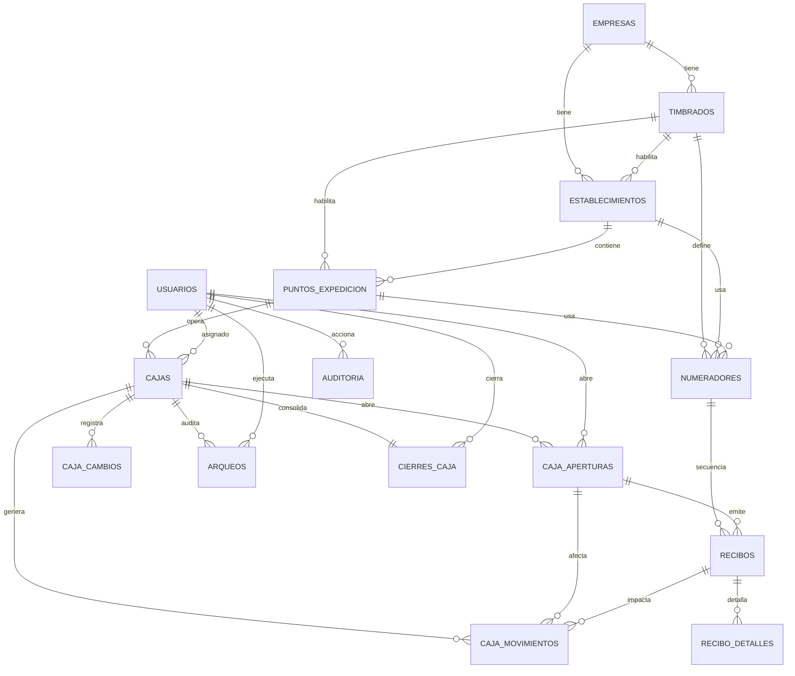

# Rediseño del Módulo de Cobranzas V12

## 1. Hallazgos del sistema actual

### Qué ya funciona y debe mantenerse en la transición

- La app móvil ya registra cobros de campo con transacción en `visitas_cobro` y actualiza `cuotas` + `asignaciones`.
- El módulo de caja ya existe en forma simplificada con `arqueos_caja` y `movimientos_caja`.
- Ya existe catálogo de `medios_pago` por empresa.
- Ya existe un modelo fiscal inicial con `facturas_emisor`, `facturas_timbrado`, `facturas`, `facturas_detalle` y `facturas_pago`.
- El sistema ya evita doble numeración de facturas usando `SELECT ... FOR UPDATE` sobre `facturas_timbrado`.

### Limitaciones reales detectadas

- La caja actual está modelada por cobrador, no por la jerarquía fiscal `empresa -> timbrado -> establecimiento -> punto -> caja -> cobrador`.
- El comprobante de cobranza depende hoy de `facturas_timbrado`, cuando el negocio necesita `recibos` con secuencia propia por punto de expedición.
- No existe una tabla formal de `numeradores`; la numeración de `facturas` sigue embebida en `facturas_timbrado.numero_actual`.
- No existe histórico formal de cambios de cobrador, de punto de expedición ni de bloqueo de caja.
- No existe auditoría transversal sobre acciones administrativas y operativas.

## 2. Decisión arquitectónica

El rediseño debe ser aditivo y por fases.

No se deben reemplazar de inmediato las tablas actuales que hoy sostienen el flujo móvil.

La estrategia correcta es:

1. Crear el nuevo modelo ERP sin borrar nada legacy.
2. Migrar catálogos y estructuras fiscales.
3. Hacer dual write en los flujos críticos.
4. Cambiar lecturas gradualmente.
5. Recién al final retirar tablas legacy verificando dependencias.

## 3. Diagrama ER

## 4. Modelo objetivo

### Jerarquía fiscal y operativa

- `empresa`: dueño del negocio y de la cartera.
- `timbrado`: autorización fiscal vigente o histórica de la empresa.
- `establecimiento`: código fiscal `001`, `002`, `003`.
- `punto_expedicion`: código fiscal `001`, `002`, `003` dentro del establecimiento.
- `caja`: unidad operativa atada a un solo punto de expedición.
- `cobrador`: usuario operativo asignado a la caja.

### Invariantes de negocio

- Una caja usa un único punto de expedición.
- Un punto de expedición solo puede tener una caja activa al mismo tiempo en el flujo operativo.
- Una caja tiene un único cobrador asignado al momento actual.
- Si cambia el cobrador, la caja no pierde historial.
- Un timbrado puede tener histórico, pero solo uno puede estar vigente para emisión operativa.
- Un número fiscal nunca se reutiliza, incluso si el recibo fue anulado.

## 5. Tablas nuevas y propósito

### `timbrados`

- Historial completo de timbrados por empresa.
- Desacopla el flujo ERP del `facturas_timbrado` legacy.

### `establecimientos`

- Representa establecimiento fiscal por empresa.
- Puede vincularse al timbrado vigente que lo habilita.

### `puntos_expedicion`

- Representa cada punto fiscal dentro del establecimiento.
- Base de la secuencia documental y de la caja.

### `cajas`

- Representa la caja operativa del cobrador.
- No guarda el historial diario; eso vive en `caja_aperturas`, `caja_movimientos`, `arqueos` y `cierres_caja`.

### `caja_cambios`

- Guarda cambios de cobrador, punto, timbrado y bloqueos.
- Evita perder trazabilidad administrativa.

### `caja_aperturas`

- Una fila por apertura diaria.
- Registra saldo inicial, hora, IP y GPS opcional.

### `caja_movimientos`

- Libro mayor de caja.
- Todo ingreso, cobranza, egreso, ajuste, anulación o cierre impacta aquí.

### `numeradores`

- Secuencia fiscal por `empresa + timbrado + establecimiento + punto + tipo_documento + serie`.
- Reemplaza cualquier patrón `MAX()+1`.

### `recibos`

- Documento de cobranza emitido al cobrar.
- Preparado para convivencia con emisión impresa actual y futura facturación electrónica.

### `recibo_detalles`

- Detalle por cuota, crédito o concepto adicional.

### `arqueos`

- Histórico de arqueos realizados durante la jornada.
- Nunca se elimina.

### `cierres_caja`

- Consolida automáticamente saldo inicial, ingresos, egresos, esperado, declarado y diferencia.

### `auditoria`

- Bitácora transversal del módulo.
- Registra usuario, IP, tabla, registro, antes y después.

## 6. Índices y claves foráneas

Todos los índices y `FOREIGN KEY` pedidos quedaron incluidos en [database/migracion_v12_cobranzas_erp_multientidad.sql](database/migracion_v12_cobranzas_erp_multientidad.sql).

Los índices más críticos son:

- `uq_numerador_scope` para garantizar una sola secuencia por ámbito fiscal.
- `uq_recibo_numero` para impedir duplicados de recibos.
- `idx_apertura_cobrador_fecha` para validar apertura del día.
- `idx_mov_caja_apertura_fecha` para cierres y arqueos eficientes.
- `idx_timbrado_empresa_estado` e `idx_timbrado_empresa_fechas` para validar vigencia.

## 7. Servicios de dominio propuestos

### `backend/src/services/cobranzas/cajaService.js`

Responsabilidades:

- validar asignación caja-cobrador
- abrir caja
- bloquear caja
- cerrar caja
- recalcular saldo actual desde movimientos

### `backend/src/services/cobranzas/numeradorService.js`

Responsabilidades:

- obtener numerador activo por punto
- bloquear fila con `SELECT ... FOR UPDATE`
- asignar siguiente número
- impedir sobrepasar `numero_hasta`

### `backend/src/services/cobranzas/reciboService.js`

Responsabilidades:

- validar timbrado vigente
- emitir recibo
- generar detalle
- generar movimiento de caja tipo `COBRANZA`
- anular recibo sin reutilizar número
- generar PDF

### `backend/src/services/cobranzas/arqueoService.js`

Responsabilidades:

- registrar arqueos históricos
- calcular saldo sistema
- consolidar cierre de caja

### `backend/src/services/cobranzas/auditoriaService.js`

Responsabilidades:

- registrar cambios administrativos y operativos
- capturar `antes` y `después`

### `backend/src/services/cobranzas/compatibilidadLegacyService.js`

Responsabilidades:

- dual write hacia tablas actuales durante la migración
- asociar `recibos` con `visitas_cobro`, `facturas` y `arqueos_caja`

## 8. Controladores y rutas propuestos

### Configuración

- `empresasController.js`
- `timbradosController.js`
- `establecimientosController.js`
- `puntosExpedicionController.js`
- `cajasController.js`
- `numeradoresController.js`

Rutas sugeridas:

- `GET/POST/PUT /api/configuracion/empresas`
- `GET/POST/PUT /api/configuracion/timbrados`
- `GET/POST/PUT /api/configuracion/establecimientos`
- `GET/POST/PUT /api/configuracion/puntos-expedicion`
- `GET/POST/PUT /api/configuracion/cajas`
- `GET/POST/PUT /api/configuracion/numeradores`

### Operaciones

- `cajaOperacionesController.js`
- `arqueosController.js`
- `movimientosCajaController.js`

Rutas sugeridas:

- `POST /api/cajas/:id/abrir`
- `POST /api/cajas/:id/cerrar`
- `POST /api/cajas/:id/arqueos`
- `GET /api/cajas/:id/movimientos`
- `POST /api/cajas/:id/bloquear`
- `POST /api/cajas/:id/asignar-cobrador`

### Cobranza

- `recibosController.js`

Rutas sugeridas:

- `POST /api/recibos/emitir`
- `POST /api/recibos/:id/anular`
- `GET /api/recibos/:id/pdf`
- `GET /api/recibos/historial`

### Consultas

- `historialCajaController.js`
- `auditoriaController.js`

Rutas sugeridas:

- `GET /api/cajas/historial`
- `GET /api/recibos/historial`
- `GET /api/auditoria`

## 9. Qué mantener del código actual

### Mantener sin reemplazar al inicio

- `backend/src/controllers/cobradorController.js`
  - El flujo de `registrarCobro` ya tiene transacción y compatibilidad con `gestiones`.
- `backend/src/controllers/arqueosController.js`
  - Sirve como base del flujo diario mientras se implementa la nueva capa.
- `backend/src/controllers/panelController.js`
  - Se debe mantener la parte histórica de facturas y timbrados ya emitidos.
- `database/migracion_v4_cobrador.sql`
  - `visitas_cobro` debe seguir siendo el log operativo fuente de visitas.
- `database/migracion_v11_arqueos_caja.sql`
  - No eliminar hasta mapear toda su información a `cajas`, `caja_aperturas` y `cierres_caja`.
- `database/migracion_v9_facturas_config.sql`
  - No eliminar porque contiene el histórico fiscal ya emitido.

## 10. Qué modificar del código actual

### Backend móvil

#### `cobradorController.registrarCobro`

Debe pasar a validar además:

- caja asignada al cobrador
- caja abierta del día
- punto de expedición de la caja
- timbrado vigente del punto
- numerador activo y no bloqueado

Debe ejecutar en una sola transacción:

1. `SELECT ... FOR UPDATE` sobre `numeradores`
2. inserción en `visitas_cobro`
3. inserción en `recibos`
4. inserción en `recibo_detalles`
5. inserción en `caja_movimientos`
6. actualización de `cuotas`
7. actualización de `asignaciones`
8. dual write opcional a `gestiones` y `facturas` mientras dure la migración

#### `arqueosController.abrirCaja`

Debe migrarse conceptualmente a:

- validar caja activa
- crear `caja_aperturas`
- generar movimiento inicial tipo `INGRESO`
- actualizar `cajas.fecha_apertura_actual` y `saldo_actual`

#### `arqueosController.cerrarCaja`

Debe migrarse conceptualmente a:

- calcular totales desde `caja_movimientos`
- crear `cierres_caja`
- cerrar `caja_aperturas`
- generar movimiento final tipo `CIERRE`

#### `panelController.generarComprobante`

Debe separarse en dos responsabilidades:

- histórico fiscal legacy de `facturas`
- nuevo PDF de `recibos`

No debe seguir tomando secuencia operativa desde `facturas_timbrado.numero_actual` para cobranzas a domicilio.

#### `panelController.updateFacturaConfig`

Debe dividirse en módulos:

- mantenimiento de timbrados
- mantenimiento de establecimientos
- mantenimiento de puntos de expedición
- mantenimiento de numeradores

## 11. Reglas de seguridad a implementar

No permitir cobrar si:

- no existe caja asignada al cobrador
- la caja está cerrada o bloqueada
- no existe apertura del día
- el punto de expedición no existe o está inactivo
- el timbrado está vencido o no vigente
- el numerador está bloqueado o no existe

## 12. Plan de migración de datos sin perder información

### Fase 1. Crear el modelo nuevo

- ejecutar la migración V12
- no borrar ninguna tabla actual

### Fase 2. Backfill fiscal

- migrar `facturas_timbrado` a `timbrados`
- crear `establecimientos` y `puntos_expedicion` a partir de los códigos actuales de `facturas_timbrado`
- crear `numeradores` con el `numero_actual - 1` como `ultimo_numero_asignado`
- ejecutar `backend/scripts/backfillCobranzasV12.js` para materializar el modelo V12 sin inventar puntos fiscales nuevos

Script disponible:

- `npm run backfill:cobranzas:v12:dry` en [backend/package.json](backend/package.json)
- `npm run backfill:cobranzas:v12` en [backend/package.json](backend/package.json)

Alcance actual del script:

- crea o vincula `timbrados`, `establecimientos`, `puntos_expedicion` y `numeradores`
- crea una `caja` por cada punto fiscal realmente existente en el legado
- asigna cobradores solo cuando existe un punto fiscal disponible para hacerlo sin inventar configuración DNIT
- reporta cobradores que quedan pendientes de configuración manual

### Fase 3. Backfill de cajas

- crear una `caja` por cada combinación operativa real de empresa y cobrador
- mapear `arqueos_caja` a `caja_aperturas`
- mapear `movimientos_caja` a `caja_movimientos`
- mapear `rendiciones` a `cierres_caja` o histórico auxiliar según fecha de cierre

### Fase 4. Backfill documental

- crear `recibos` para cada `visitas_cobro` con resultado `cobrado`
- enlazar con `facturas` legacy cuando exista comprobante ya emitido
- respetar números históricos: si ya existe factura legal, guardar referencia en `factura_legacy_id`

### Fase 5. Dual write

- cada cobro nuevo escribe en modelo nuevo y legacy
- cada apertura/cierre escribe en modelo nuevo y legacy

### Fase 6. Cambio de lecturas

- reportes administrativos empiezan a leer desde `recibos`, `caja_movimientos`, `arqueos` y `cierres_caja`
- el móvil sigue leyendo compatibilidad mientras se completa QA

### Fase 7. Retiro controlado

- no eliminar `facturas_timbrado`, `facturas`, `arqueos_caja`, `movimientos_caja` ni `gestiones` hasta validar:
  - reportes equivalentes
  - secuencias correctas
  - cierres diarios correctos
  - ausencia de integraciones dependientes

## 13. Orden sugerido de implementación

1. Migración V12.
2. ABM web de timbrados, establecimientos, puntos, cajas y numeradores.
3. Servicios de caja y numerador.
4. Emisión de recibo con dual write.
5. Cierre y arqueo sobre el nuevo libro de movimientos.
6. Reportes y auditoría.
7. Corte de lecturas legacy.

## 14. Conclusión técnica

No conviene “parchar” el modelo actual agregando solo columnas sobre `arqueos_caja` o `facturas_timbrado`.

El módulo actual ya resolvió operación móvil, pero todavía no modela la jerarquía fiscal ni la trazabilidad ERP que necesitas.

Por eso el rediseño correcto es:

- conservar el flujo actual como compatibilidad,
- introducir el nuevo núcleo de `timbrados + puntos + cajas + numeradores + recibos + auditoría`,
- migrar por fases,
- y recién después retirar el modelo legacy.